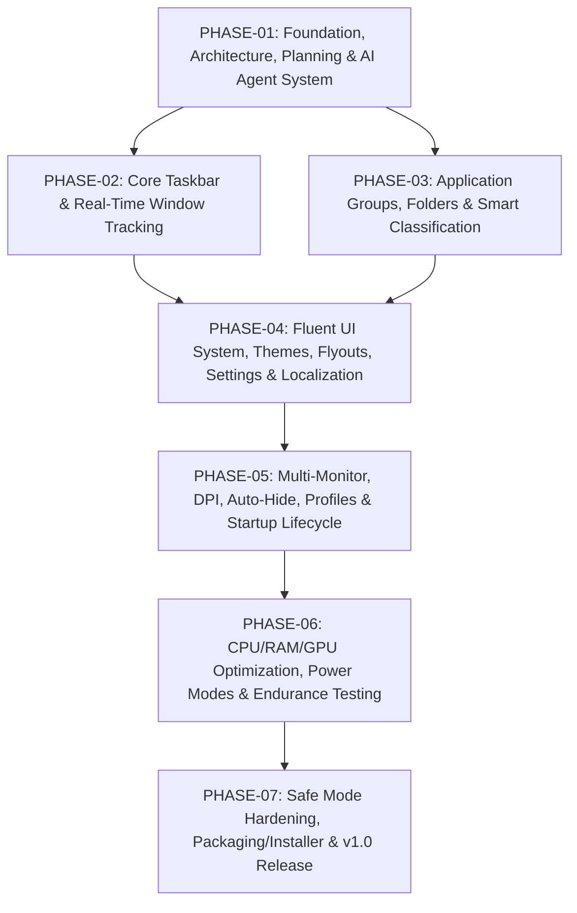

# Dockyra Development Roadmap (`planning/ROADMAP.md`)

This document defines the staged engineering roadmap for **Dockyra**, including phase dependencies, target modules, technical risks, verification requirements, and acceptance criteria.

---

## Phase Dependency Graph

---

## Phase Breakdown

### PHASE-01: Foundation, Architecture, Planning & AI Agent System
- **Spec**: [phases/phase-01-foundation.md](phases/phase-01-foundation.md)
- **Status**: `IN_PROGRESS` (Core Foundation Completed)
- **Prerequisites**: None.
- **Affected Modules**: `MOD-CORE`, `MOD-SETTINGS`, `MOD-THEMES`
- **Deliverables**:
  - `.NET 10` Clean Architecture solution (`Dockyra.sln`) with strict UI/OS separation.
  - SQLite schema migration engine and repository layer.
  - `planning/` knowledge base, `module-registry.yaml`, and `scripts/validate-planning.ps1`.
  - `AGENTS.md`, `.agents/agents/`, `.agents/rules/`, and `.agents/skills/`.
  - Automated `Dockyra.ArchitectureTests`.

### PHASE-02: Core Taskbar & Real-Time Window Tracking
- **Spec**: [phases/phase-02-taskbar.md](phases/phase-02-taskbar.md)
- **Status**: `IN_PROGRESS` (Prototype Active)
- **Prerequisites**: `PHASE-01`
- **Affected Modules**: `MOD-TASKBAR`, `MOD-WINDOWS`
- **Deliverables**:
  - `Win32WindowManager` with `EnumWindows`, `DWMWA_CLOAKED` filtering, and `SetWinEventHook` event tracking.
  - Docked `TaskbarWindow` showing open applications, active window indicator, and window activation/minimize/restore/close actions.

### PHASE-03: Application Groups, Folders & Smart Classification
- **Spec**: [phases/phase-03-groups.md](phases/phase-03-groups.md)
- **Status**: `IN_PROGRESS` (Domain & Persistence Complete; Drag-and-Drop UI Next)
- **Prerequisites**: `PHASE-01`, `PHASE-02`
- **Affected Modules**: `MOD-GROUPS`, `MOD-FOLDERS`
- **Deliverables**:
  - Custom application groups with color, icon, sort order, and SQLite persistence.
  - Expandable folder flyout (`FolderFlyoutControl`) with search, Grid/List mode, and bounded subfolder depth (`MaxDepth = 3`).
  - `SmartGroupingRuleEngine` prioritizing user rules over automatic matching.
  - Drag-and-drop item reordering (`TASK-0008`).

### PHASE-04: Fluent UI System, Themes, Flyouts, Settings & Localization
- **Spec**: [phases/phase-04-ui.md](phases/phase-04-ui.md)
- **Status**: `READY`
- **Prerequisites**: `PHASE-02`, `PHASE-03`
- **Affected Modules**: `MOD-THEMES`, `MOD-SETTINGS`, `MOD-TASKBAR`
- **Deliverables**:
  - Complete Fluent Dark/Light theme switching and design token coverage.
  - Full 12-section `SettingsWindow` (`TASK-0009`).
  - Complete `tr-TR` and `en-US` localization and keyboard accessibility.

### PHASE-05: Multi-Monitor, DPI, Auto-Hide, Profiles & Startup Lifecycle
- **Spec**: [phases/phase-05-integration.md](phases/phase-05-integration.md)
- **Status**: `BACKLOG`
- **Prerequisites**: `PHASE-04`
- **Affected Modules**: `MOD-TASKBAR`, `MOD-PROFILES`, `MOD-WINDOWS`
- **Deliverables**:
  - Per-monitor independent taskbar windows (`TASK-0010`) and dynamic display hot-plug handling.
  - Per-Monitor V2 DPI scaling adaptation.
  - Fullscreen application detection and auto-hide behavior.
  - Startup registration (`HKCU\Software\Microsoft\Windows\CurrentVersion\Run` opt-in only).

### PHASE-06: CPU/RAM/GPU Optimization, Power Modes & Endurance Testing
- **Spec**: [phases/phase-06-performance.md](phases/phase-06-performance.md)
- **Status**: `BACKLOG`
- **Prerequisites**: `PHASE-05`
- **Affected Modules**: `MOD-PERFORMANCE`, `MOD-POWER`
- **Deliverables**:
  - Adaptive `PowerSaver`, `Balanced`, and `Performance` mode tuning.
  - Icon caching and memory leak endurance verification (`< 0.5%` idle CPU, `< 150 MB` RAM target).

### PHASE-07: Safe Mode Hardening, Packaging/Installer & v1.0 Release
- **Spec**: [phases/phase-07-release.md](phases/phase-07-release.md)
- **Status**: `BACKLOG`
- **Prerequisites**: `PHASE-06`
- **Affected Modules**: `MOD-CORE`, `MOD-SETTINGS`
- **Deliverables**:
  - End-to-end Safe Mode recovery UI and configuration reset.
  - Windows installer and clean uninstaller with optional user data cleanup (`TASK-0012`).
  - v1.0 Release Candidate verification.

