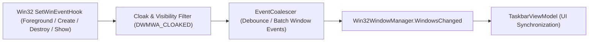

# Event Flow (`planning/architecture/event-flow.md`)

## 1. Event-Driven Architecture Principle
Dockyra avoids high-frequency polling loops. Instead, OS-level changes are captured through native callbacks, filtered, coalesced (`EventCoalescer`), and pushed to application subscribers.

## 2. Coalescing & Power-Mode Throttling
- Window events often fire in bursts (e.g., dozens of `EVENT_OBJECT_SHOW` / `EVENT_OBJECT_NAMECHANGE` events within 10ms when an application starts).
- `EventCoalescer` batches rapid notifications within a configurable quiet window (`80ms` in `Balanced`/`Performance`, `200ms` in `PowerSaver`) so `EnumWindows` and UI bindings execute at most once per burst.
- Power events (`GetSystemPowerStatus` / AC-Battery transitions) publish `PowerStateChangedEventArgs` through `IPowerMonitor` to `PowerModeCoordinator`, which automatically switches to `PowerSaver` on battery when configured by the user.

