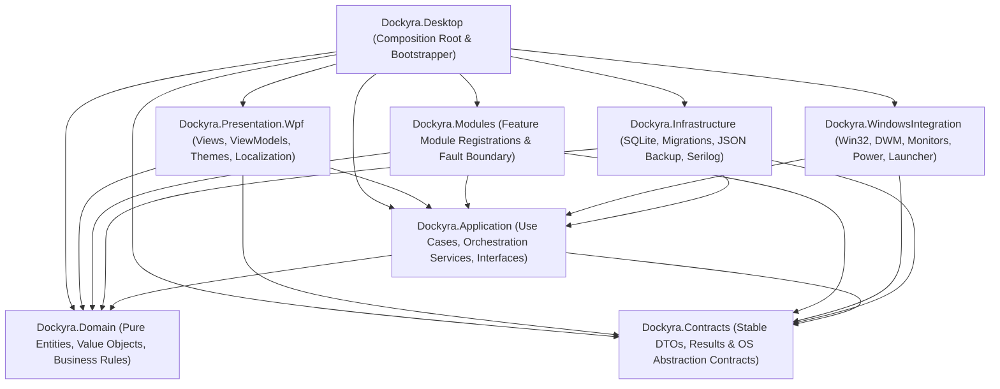

# System Overview (`planning/architecture/system-overview.md`)

## 1. Architectural Pattern
Dockyra combines **Clean Architecture** with a **Modular Monolith** and **MVVM** presentation layer on `.NET 10`.

## 2. Layer Responsibilities

| Project | Target Framework | Responsibility |
|---|---|---|
| `Dockyra.Domain` | `net10.0` | Pure domain entities (`TaskbarLayout`, `ApplicationGroup`, `FolderItem`, `WorkProfile`), value objects, and deterministic rules (`SmartGroupingRuleEngine`, `FolderHierarchyRules`, `TaskbarLayoutValidator`). Zero dependencies. |
| `Dockyra.Contracts` | `net10.0` | Cross-layer and cross-module interfaces (`IWindowManager`, `IMonitorService`, `IPowerMonitor`, `IApplicationLauncher`, `IModule`), `WindowId`, and `OperationResult`. |
| `Dockyra.Application` | `net10.0` | Application use cases (`TaskbarOrchestrationService`, `ApplicationGroupService`, `WindowSwitchUseCase`, `PowerModeCoordinator`, `SafeModeStartupCoordinator`) and repository interfaces. |
| `Dockyra.Infrastructure` | `net10.0` | SQLite persistence (`DatabaseMigrator`, repositories), schema-versioned JSON settings backup/restore, `FileSafeModeStateStore`, and Serilog logging. |
| `Dockyra.WindowsIntegration` | `net10.0-windows` | Win32, DWM, Shell, monitor, power, and process launch implementations (`Win32WindowManager`, `Win32MonitorService`, `Win32PowerMonitor`, `Win32ApplicationLauncher`). |
| `Dockyra.Modules` | `net10.0` | Self-contained module descriptors (`TaskbarModule`, `GroupsModule`, `FoldersModule`, etc.) and fault-isolated `ModuleHostService`. |
| `Dockyra.Presentation.Wpf` | `net10.0-windows` | WPF Views, MVVM ViewModels (`CommunityToolkit.Mvvm`), Fluent `DesignTokens`, themes, and `tr-TR`/`en-US` localization. |
| `Dockyra.Desktop` | `net10.0-windows` | Application entry point (`App.xaml.cs`), single-instance guard, DI container setup (`ServiceRegistration.cs`), and global exception recovery. |

